# Casino World

A living 2D casino you play together in the browser. You walk your character around the floor past other players and NPCs, sit down at a table or a slot machine, and play alongside dealers who deal, call and pay out at a real table's pace.

> **This is very much a work in progress.** It'll be hosted online at some point so anyone can just open a link and play, but it's still under development and things change most days. Expect rough edges.

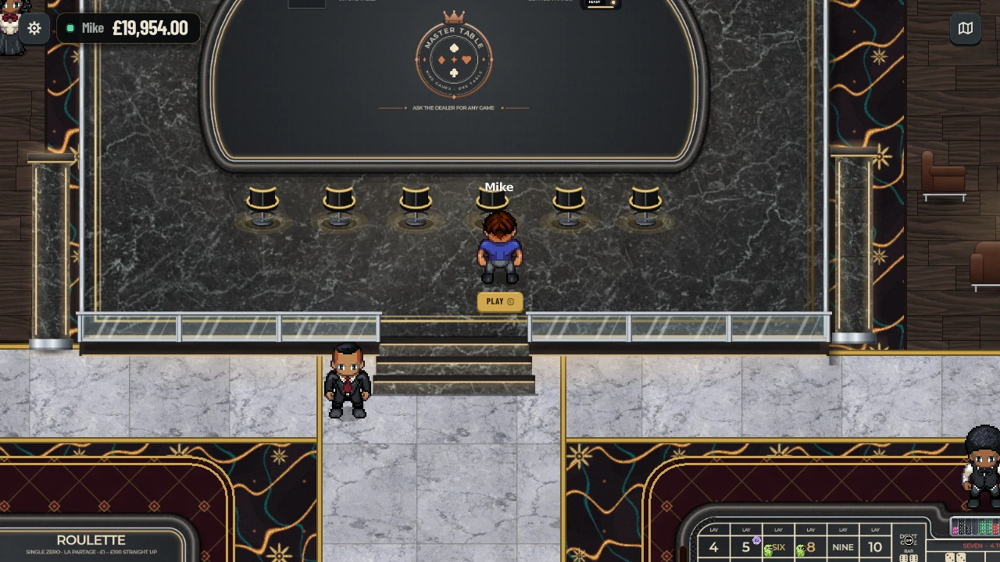

## Background

I like to gamble, and I don't mind a house edge, but I don't give casinos any more money than I need to. If my lack of knowledge costs me an extra 3% house edge, then I'm not playing. That's why I built the first version of [Hadfield Casino](https://github.com/mjhadfield/Casino), and then v2: so I could learn to play Blackjack properly, as it's usually the only game going in a UK casino. Learning Craps for the next time I'm in Vegas also seemed like a good idea. 

Casino World is the continuation of that project. Hadfield Casino v2 ended up effectively feature complete as a single player desktop game, and the obvious next step was to make it feel like actually being in a casino: walking in, wandering round the tables, and sitting down next to other people.

## What came over from v2

- **The rules.** Every card game's rules engine was ported straight across, with the same paytables and side bets. Each one is tested against v2 to the penny over 8,000 to 20,000 hands, so nothing changed in the move.
- **The attention to detail.** v2's whole aim was to feel like sitting at a real table rather than a spreadsheet exercise, and that's carried on here, just with far more room to do it.
- **The shared progressive jackpot,** the proper casino chip colours, and small things like the Blackjack dealer peek.

What didn't come over: Tkinter (it's now a Godot game in the browser talking to a Python server), the story mode and the Crowns store, and any saves. Everyone starts fresh.

## How it got here

The very first version had a separate game screen that opened when you sat down, and I scrapped it straight away. I wanted one continuous casino, where the camera glides onto the actual table you've just walked up to, and anyone walking past can stop and watch a hand.

From there the other card games came back one at a time, followed by two that v2 never had, Roulette and Craps, then the slots. I can't take much credit for the slots, Claude one-shot a slot machine from a technical document which was 90% of the way there. 

It's also grown a lot of tooling along the way: an admin page to build the casino floor room by room, design the tables, manage the NPCs and the sounds, and a wizard for designing new slot machines based on Claude's architecture. Slots are terrible anyway, you shouldn't play them. 

## The Master Table

A break from realism, but virtual gaming has to have some advantages. This was also great for debugging and testing, access to every game from a single table rather than walking round the casino trying to find an open seat. Sit down and the dealer asks what you'd like to play.

| A blank Master Table | Choosing a game |
|---|---|
| 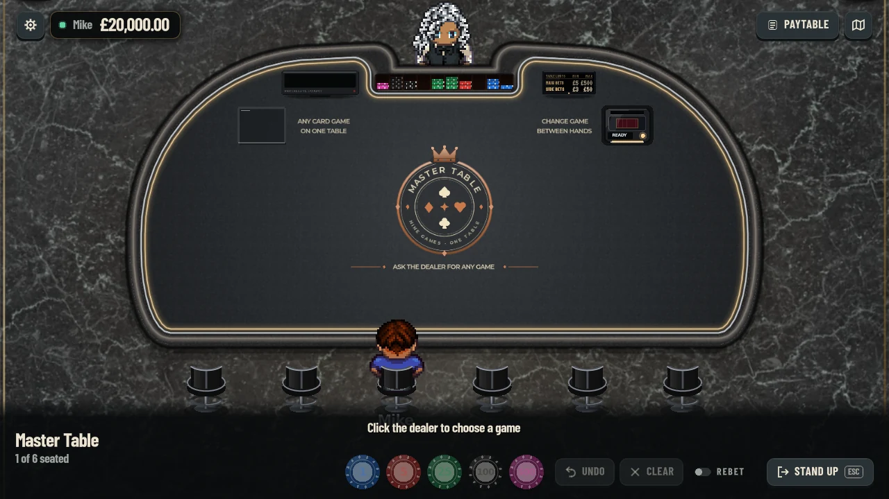 | 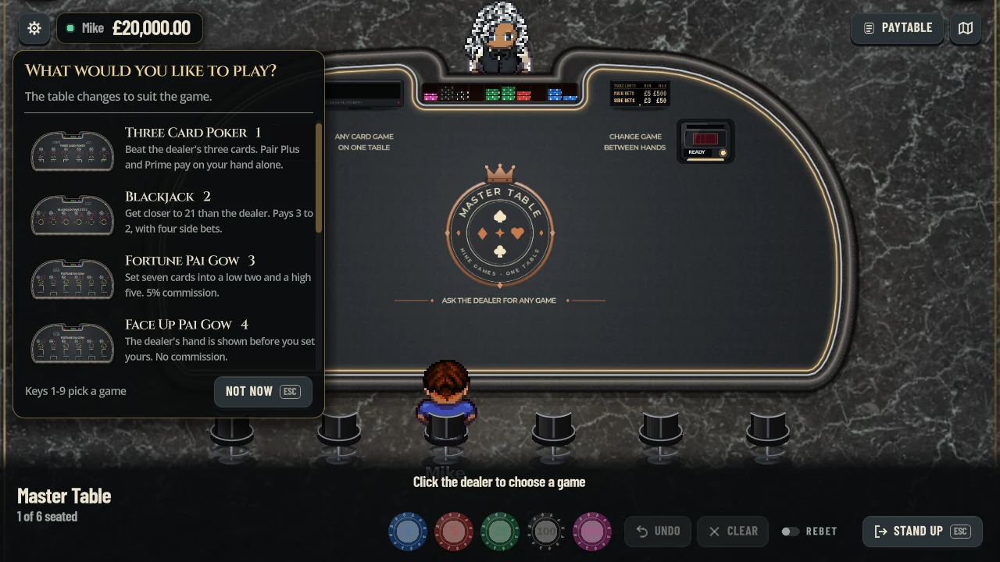 |

Anyone else sitting there gets a vote (10 seconds, saying nothing counts as yes, one no keeps the game), changes only ever happen between hands, and the shuffler, shoe and discard rack glide to wherever the new game wants them. When a change takes a six-seat game down to five seats, the chairs slide over with people still sat in them.

There are three animations for the change, picked per table:

| Gold dust | Fresh cloth | Dealer's sweep |
|---|---|---|
| 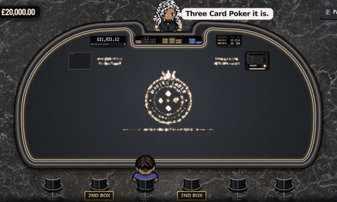 | 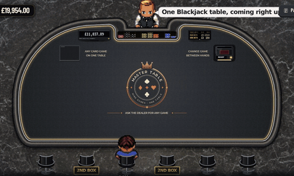 | 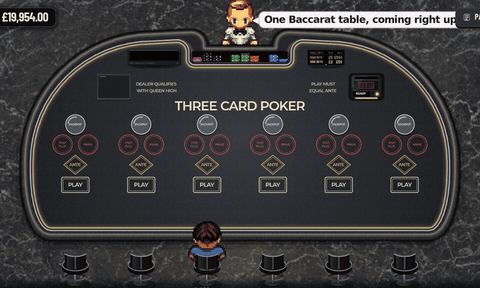 |
| The printing breaks into gold dust that drifts across and settles into the new layout | A new cloth rolls down from the dealer's side, uncovering the new game | The printing flies into the chip tray seat by seat, a sheen crosses the felt, then the new layout deals back out |

The NPCs react to it too. Most stay for the new game, but some get up and leave (a card counter will only ever stay for Blackjack). If everyone walks away, the table keeps its game for 30 seconds in case you come back, then goes back to the crest.

## Three Card Poker

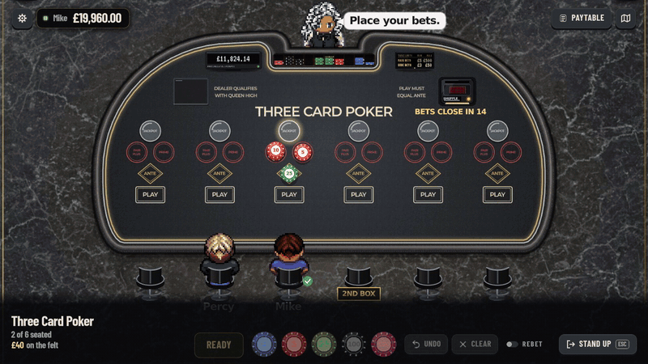

Three Card Poker was where v2 went furthest, and it's had the same treatment here. I spent a lot of time on the animations getting them to "feel" right, tucking a folding hand under the prime, flicking the ante bet back when the dealer doesn't qualify, the little touches. 

## Playing two boxes

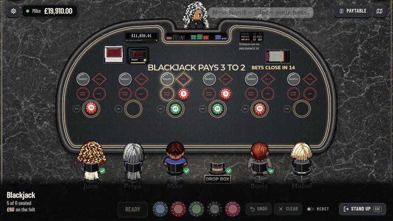

A **2nd Box** pill shows on any free chair beside you (except in Baccarat). Click it and every bet you make is matched on the second seat, which is dealt, decided, and settled as a hand of its own.

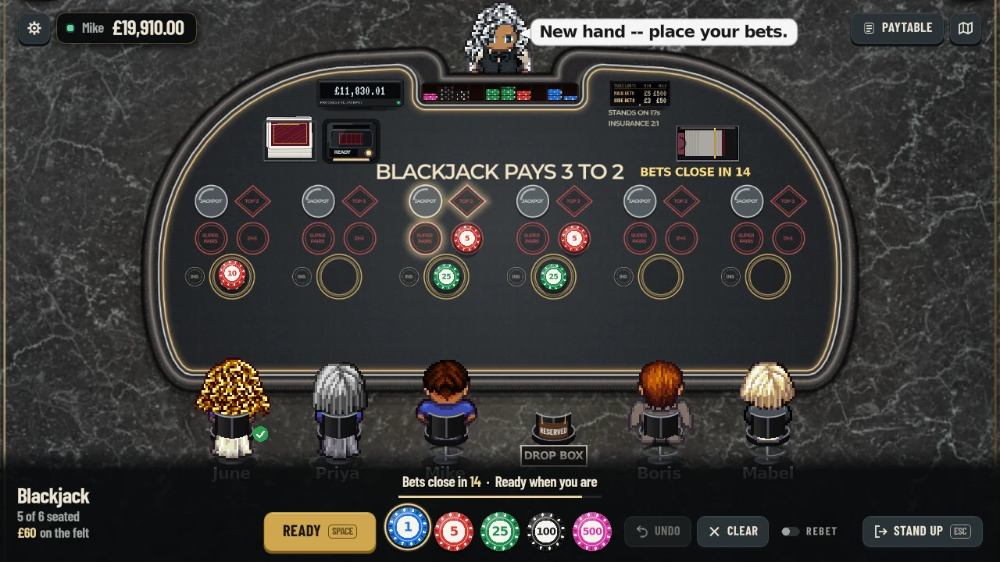

## Craps

I've put a lot of time into this one. Craps was the game I knew least about, and the whole point was to learn it properly, so I wanted the table to be right rather than just look right.

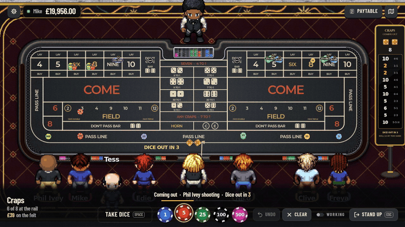

It's played to Vegas rules, standing at the rail with up to eight players:

- **Every bet** you'd find on a real table: the line with odds up to 3-4-5x, Come and Don't Come (which travel to their number), Place, Buy and Lay, the Field, Big 6/8, the hardways and all the one-roll props.
- **The number boxes are split like a real layout:** Lay along the top, Place on the number, Buy along the bottom. Odds on a come bet sit on top of it, sharing one tag ("5+10").
- **Paid in whole pounds.** The house pays in chips, so a £5 place bet on the 6 would only win £5, not £5.83. To stop that ever happening to you, chips go down in each bet's proper unit, so a £5 chip places the 6 for £6.
- **The vig is taken like it is in a casino.** On a buy bet it comes out of the win (paid in full, then the vig chips go into the rack). On a lay bet it's paid up front as the dice go out.
- **The dice are planned on the server,** so everyone at the table sees the same throw bounce off the walls, the chips, the pucks and the dealer's OFF buttons, and a die never lands resting on a chip.
- **The NPCs each have a style.** Grinders play the line with full odds and a couple of come bets, casual players stick to the line and Place 6 and 8, gamblers go for the Field, hardways and props, and a few superstitious ones bet the dark side.
- **You can take the dice** from an NPC shooter, and a scoreboard by the table shows the last rolls.

Every bet's house edge is tested against the published figure, including the vig, and every proper unit is checked to pay whole pounds on every roll.

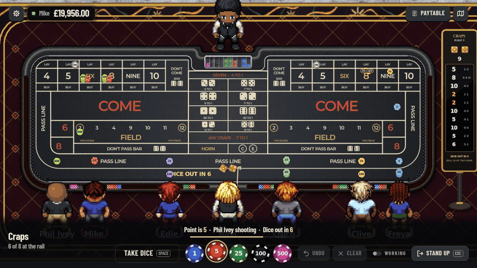

## The rest of the floor

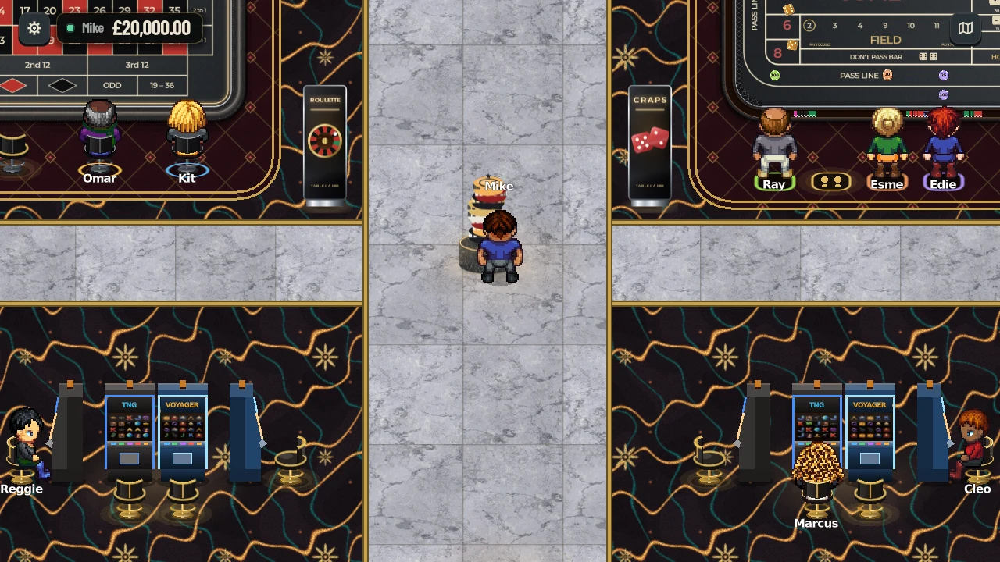

- **Roulette:** single zero, none of that double zero American nonsense. 
- **Every other card game from v2:** Blackjack, Fortune and Face Up Pai Gow, Mississippi Stud, Ultimate Texas Hold'em, Let It Ride, High Card Flush and Baccarat.
- **NPCs** who come in, wander, play and leave. Each punter has a style (Grinder, Casual or Gambler), traits like Whale, Chaser or Card counter, favourite games and a budget they're willing to lose, and they go home bust, bored or ahead. They play proper strategy, but the casual ones occasionally make a believable mistake on a close call (never a daft one).
- **Dealers** work shifts and talk. They announce hands, react to big wins and commiserate when you bust.
- **Table limits** on every card table, shown on a little sign on the dealer's ledge.
- **Money** is split into cash in hand and a bank balance. There's no free top up: if you go broke, you go to the ATM in the lobby.
- **Characters:** a device can hold up to three, each with its own look, money and stats. The difficulty only sets how much you start with in the bank.

| Choosing a character | The character designer |
|---|---|
| 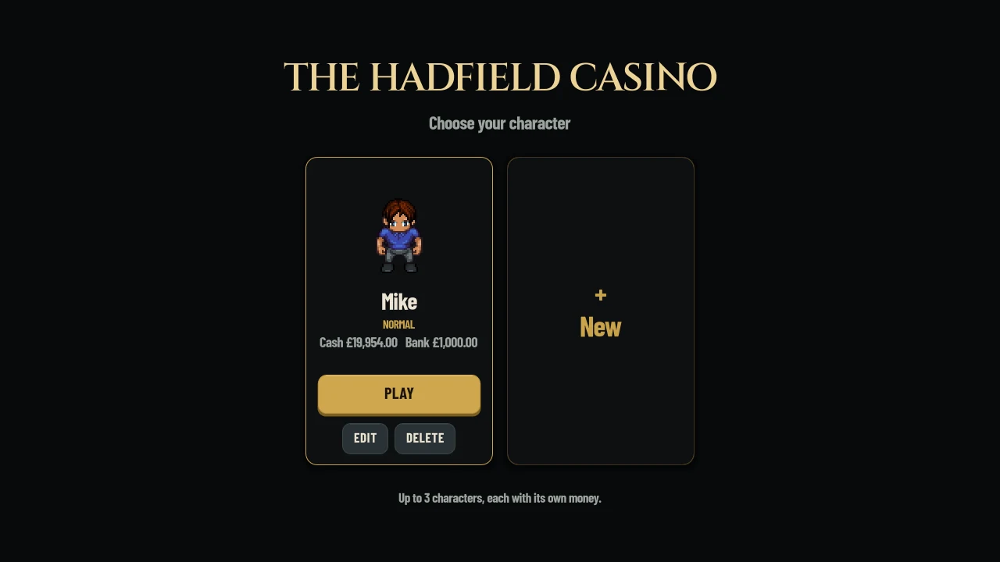 | 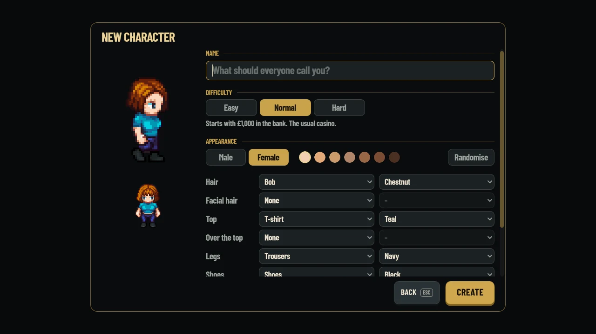 |

## Slots

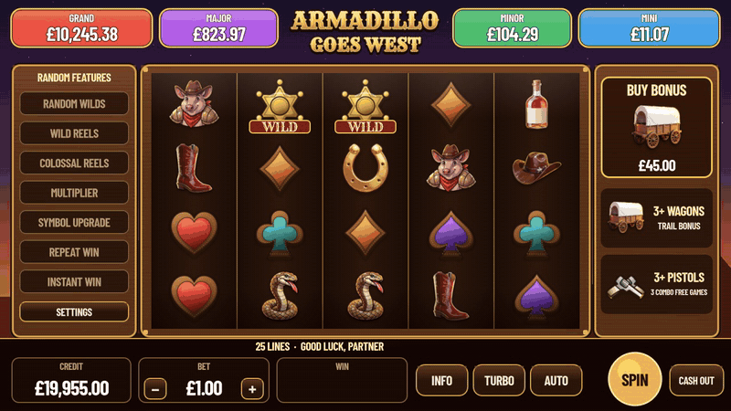

**Armadillo Goes West** was the first, with seven random features, four progressive jackpots shared by every machine, a trail bonus, free games and a Jackpot Pick. Claude Sonnet 5.5 one shot this and it came out incredibly well without much further follow up work. It's not perfect, but I hate slot machines, don't play them, and don't care. I might put some love into them eventually. 

The rest are built with a slot design wizard on the admin page, eleven steps from the concept to installing it on the floor. The symbols are generated by an image model running locally, then cut, framed and lettered in code so a set always matches. The maths gets simulated in the browser and tuned to a target return, and it's only frozen once the server has replayed the same spins and matched them exactly, so the mockup and the real machine play the same game. I've used it to build a few themed machines for myself, each with its own bonus game.

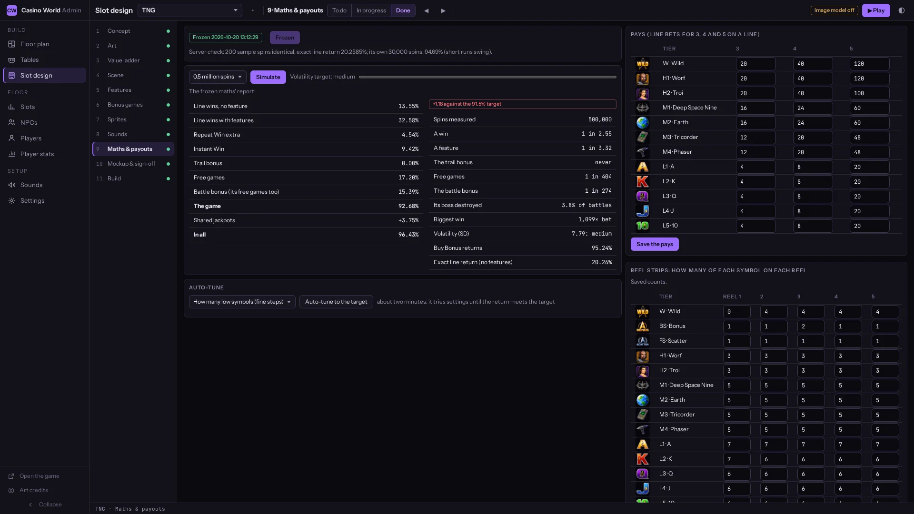

## Building the casino

The floor isn't hard-coded. It's built on the admin page, room by room: drag rooms into place, join them with doors, then lay out the tables, slot banks, furniture, rugs and where the NPCs wander. Preview it, then publish. There can be several casinos running side by side, each with its own floor.

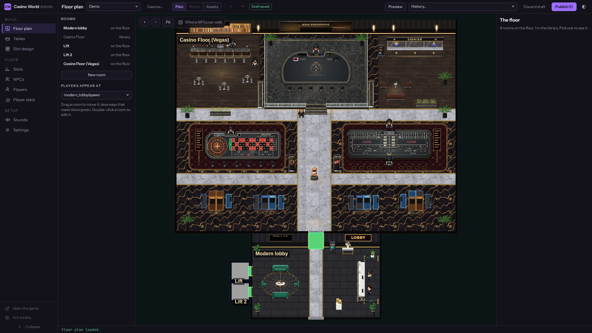

The tables can be restyled too: the felt, the rail, the printing, the chip tray, card backs, chairs and so on, drawn on the game's real layout as you change it.

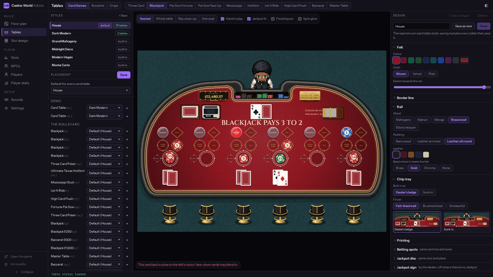

And every NPC can be designed, from their look to how they play.

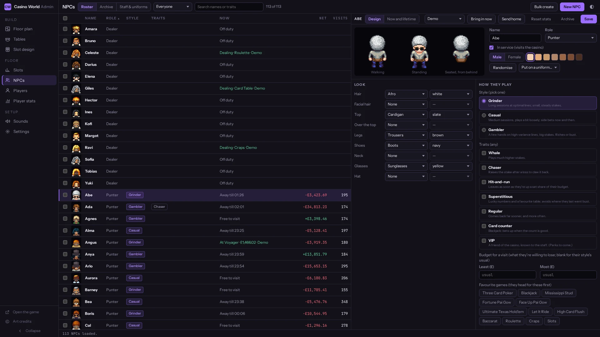

## How it's built

- **The client** is a Godot 4.7 game written in GDScript and exported to the web, so players just open a link.
- **The server** is a Python FastAPI app, and it's in charge of everything: it runs the tables, the dealers and the NPCs, holds the wallets, and decides every result and every penny. The browser only draws what it's told and sends what you want to do.
- **The art** is LPC pixel art for the people, with the tables, chips and cards mostly drawn in code.

If you want to dig into it, [docs/games/](docs/games/README.md) has how every game plays, [docs/architecture.md](docs/architecture.md) how it all fits together, and [docs/development.md](docs/development.md) the setup and a map of the code.

## Can I play it?

Not yet. It runs on my home server for now, and once it's in a state I'm happy with it'll go online. You're welcome to have a look at the code in the meantime.

## Credits

The character sprites come from the [Universal LPC Spritesheet Character Generator](https://github.com/LiberatedPixelCup/Universal-LPC-Spritesheet-Character-Generator) and the furniture from LPC packs on [OpenGameArt](https://opengameart.org/), the sounds are CC0, and the wood, leather, felt and marble textures come from [Poly Haven](https://polyhaven.com/) and [ambientCG](https://ambientcg.com/). The full credits are in [the sprite credits](client/assets/sprites/CREDITS.md), [the furniture credits](server/plan_assets/CREDITS.md), [the sound library](server/sound_library/LIBRARY.md), [the table textures](docs/table_styles/LICENSES.md) and [the floor textures](tools/vegas_floor/textures/CREDITS.md).
